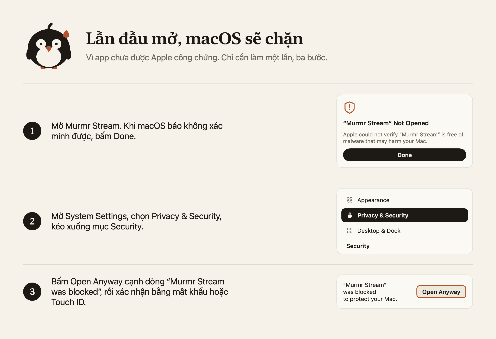

---

## Install

1. Download **Murmr-Stream.dmg** from **Assets** below, open it and drag **Murmr Stream** into **Applications**.
2. Eject the disk image and open the app **from Applications** (not from inside the disk image).
3. The first launch is blocked by macOS because the app is not notarized yet. Click **Done**, open **System Settings → Privacy & Security**, scroll to **Security**, click **Open Anyway** next to "Murmr Stream was blocked" and confirm with your password. (On macOS 14 you can also right-click the app and choose **Open**.)

   
4. Choose your dictation key in the welcome window and allow the permissions macOS asks for: Microphone, Input Monitoring, Accessibility.
5. On first launch the app downloads two speech models (574 MB), which needs a network connection once.

Needs a Mac with Apple Silicon and macOS 14 or later (built for 14, tested on macOS 15 and later).
Checksum: `shasum -a 256 -c Murmr-Stream-<version>.dmg.sha256` (file in Assets). Privacy: [PRIVACY.md](https://github.com/trvux/murmr/blob/main/PRIVACY.md).

## Cài đặt

1. Tải **Murmr-Stream.dmg** ở mục **Assets** bên dưới, mở ra và kéo **Murmr Stream** vào **Applications**.
2. Eject ổ đĩa cài đặt rồi mở app **từ Applications** (không mở từ bên trong ổ đĩa cài đặt).
3. Lần đầu mở, macOS sẽ chặn vì app chưa được Apple công chứng. Bấm **Done**, mở **System Settings → Privacy & Security**, kéo xuống mục **Security**, bấm **Open Anyway** cạnh dòng "Murmr Stream was blocked" và xác nhận bằng mật khẩu. (Trên macOS 14 cũng có thể bấm chuột phải vào app, chọn **Open**.)

   
4. Chọn phím nói trong cửa sổ chào và cho phép các quyền macOS hỏi: Micro, Giám sát đầu vào, Trợ năng.
5. Lần mở đầu app tải hai model giọng nói (574 MB), cần có mạng một lần.

Cần máy Mac chip Apple Silicon và macOS 14 trở lên (build cho 14, đã thử trên macOS 15 trở lên).
Checksum: `shasum -a 256 -c Murmr-Stream-<version>.dmg.sha256` (file ở mục Assets). Quyền riêng tư: [PRIVACY.vi.md](https://github.com/trvux/murmr/blob/main/PRIVACY.vi.md).
