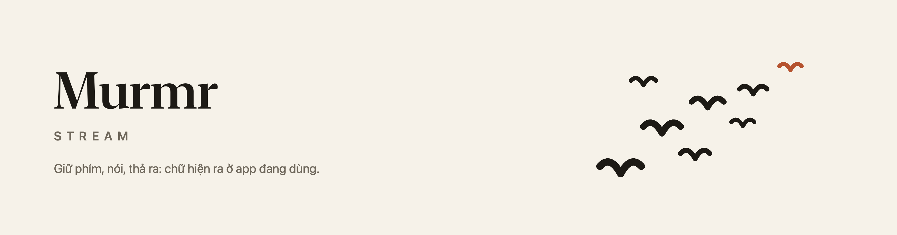
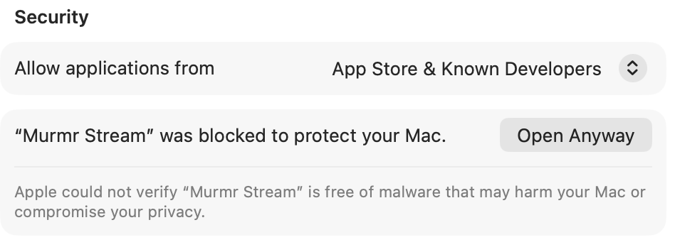

<p align="center">
  <picture>
    <source media="(prefers-color-scheme: dark)" srcset="docs/banner-dark.png">
    
  </picture>
</p>

# Murmr Stream

Hold a key, speak, release: your words appear in whatever app has focus. A free, local-first
dictation tool for macOS, built for **Vietnamese mixed with English**, written in Go.
(The repo and the command are both called `murmr`.)

Inspired by [Wispr Flow](https://wisprflow.ai). Not affiliated with it.

```
hold RIGHT Option -> microphone (16 kHz)
   -> whisper-server (local, model stays loaded, Metal)  -> raw text
   -> DeepSeek / Claude cleanup (fillers, punctuation, mis-heard terms, pronouns)
   -> clipboard + Cmd+V into the focused app
```

## Download

Get the latest build from the [Releases page](https://github.com/trvux/murmr/releases): open the `.dmg`, drag
**Murmr Stream** into Applications. Every version has its own page with notes of what changed (they come from
[CHANGELOG.md](CHANGELOG.md)) and a checksum. Needs Apple Silicon and macOS 14 or later (built for 14; tested on
macOS 15 and later, there is no Mac on 14 to try it on).

**The first time you open it, macOS blocks it**, because the app is not notarized by Apple (that costs a yearly fee
that this free project does not pay yet). It is a one-time step:

1. Open the app once and dismiss the warning ("Done").
2. Open **System Settings → Privacy & Security** and scroll down to **Security**.
3. Click **Open Anyway** next to "Murmr Stream was blocked", and confirm with your password or Touch ID.



After that it opens like any other app, and a short welcome window walks through the permissions.

## What it does

- **Hold-to-talk** on the right Option key (a listen-only `CGEventTap`; the key still works normally).
- **Local speech-to-text**: whisper.cpp `large-v3-turbo` (q5_0) behind `whisper-server`, with Silero VAD so
  silence and noise are ignored instead of turned into invented text.
- **LLM cleanup** with DeepSeek (default) or Claude Haiku: removes fillers, fixes punctuation and
  mis-heard English tech terms, keeps mixed Vietnamese/English as spoken. If the API fails or times out,
  the raw transcript is pasted.
- **Personal dictionary** (`~/.config/murmr/dictionary.txt`): terms and `wrong -> Right` fixes, fed to
  both Whisper's prompt and the LLM.
- **Learns from use**: recurring "heard X, meant Y" corrections found in your history become soft
  hints for the LLM.
- **Per-app pronoun style**: casual (`tao/mày`) in terminals and AI apps, neutral elsewhere, with
  window-title rules (e.g. a browser tab ending in "- Gmail" is neutral).
- **Pronunciation practice** (`drill`): phoneme-level feedback, optionally replayed in your own voice.

## Status

Built and tested on one machine (MacBook Pro M2 Pro, macOS) and mostly with one speaker.
Measured there: about 1.8 s to transcribe a 20 s clip, and roughly 2-3 s from releasing the key to the
text being pasted. Whisper still mishears English tech terms spoken with a Vietnamese accent
(for example `crash` as `cache`); the cleanup step fixes many of these from context but not all.
The phoneme scorer was only validated on synthetic voices and one real speaker, so treat its numbers
as relative, not absolute.

## Requirements

macOS on Apple Silicon, Go 1.27+, and:

```sh
brew install whisper-cpp
```

Optional, for the pronunciation tools: `brew install uv espeak-ng ffmpeg`.

## Install

```sh
git clone https://github.com/trvux/murmr && cd murmr
go build -o murmr .

mkdir -p models
curl -L -o models/ggml-large-v3-turbo-q5_0.bin \
  https://huggingface.co/ggerganov/whisper.cpp/resolve/main/ggml-large-v3-turbo-q5_0.bin
curl -L -o models/ggml-silero-v5.1.2.bin \
  https://huggingface.co/ggml-org/whisper-vad/resolve/main/ggml-silero-v5.1.2.bin

mkdir -p ~/.config/murmr && chmod 700 ~/.config/murmr
echo 'export DEEPSEEK_API_KEY=...' > ~/.config/murmr/env && chmod 600 ~/.config/murmr/env
./run.sh
```

macOS will ask for **Microphone**, **Input Monitoring** (the Option key) and **Accessibility** (pasting)
for your terminal. Without a cleanup key it still works, with raw Whisper output.

## macOS app

`app/` is a menu-bar app (Swift, SwiftUI, no Xcode needed) that runs the Go engine and draws the
state on the notch: a black pill grows out of it while you hold the key, shows a slim wave that
follows your voice, then "Đang chép lời" / "Đang dọn văn", then the pasted text. On a screen without a
notch it floats under the top edge.

```sh
app/scripts/bundle.sh                 # builds the engine, whisper-server and "Murmr Stream.app" into app/build/
open "app/build/Murmr Stream.app"
```

- **Nothing to install for users.** The app carries its own `whisper-server`: one self-contained file built from
  whisper.cpp by `app/scripts/build-whisper.sh` (static, Metal embedded, runs on macOS 14 or later; the first
  `bundle.sh` runs it for you and needs `brew install cmake`). Homebrew's `whisper-cpp` is only needed to run from
  a terminal with `./run.sh`; it links libraries by absolute path and is built for the newest macOS only, so it
  cannot be copied into an app. On start the engine also stops an orphaned `whisper-server` left on its port by a
  crashed run.
- **Welcome window.** On first launch (and from the menu, "Hướng dẫn ban đầu…") a short guide walks through the three
  permissions with live status, then the model download. The mascot is drawn in `Theme.swift` (`Mascot`, six moods).
- **Permissions.** The app asks for Microphone, Input Monitoring (the Option key) and Accessibility
  (pasting). With ad-hoc signing macOS forgets them on every rebuild; to keep them, create a self-signed
  code-signing certificate in your keychain and build with `MURMR_SIGN_ID="<its name>" app/scripts/bundle.sh`.
- **Settings** (menu bar icon, "Cài đặt…"):
  - **Từ điển** edits `dictionary.txt` (terms, hard fixes, and the pairs learned from your history, which you
    can drop) without touching the file's comments.
  - **Ứng dụng** chooses, per app, whether dictation uses casual `tao/mày` or neutral pronouns (or the
    default), and lets you add window-title rules. It edits `apps.txt` for you and applies at once.
  - **AI và khoá API** picks DeepSeek or Claude, stores the key in the **macOS Keychain**, tests it, lists the models your key can use so you pick one (newest first, older ones folded), and lists
    exactly what is and is not sent. Changing keys or provider asks for an engine restart.
  - **Giao diện** chooses the wave style (five, shown side by side) and the notch corner shape.
  - **Chung** shows the engine status.

  A thin bar at the foot of the sidebar shows engine startup progress (an estimate: the engine reports each
  step, and loading Whisper is the long one).
- **Logs** go to `~/Library/Logs/Murmr Stream/engine.log`. The dictated text is never written there.
- Only one engine can run at a time (they share port 8178, the microphone and the key), so quit
  `./run.sh` before opening the app.
- Live captions while you speak exist but are off by default (`MURMR_PREVIEW=on`): they need a second,
  faster Whisper server (about 600 MB more RAM) and only update about every 0.6 s, because Whisper
  encodes a fixed window per decode.

Not notarized yet, so a downloaded build will trigger macOS's unidentified-developer warning.

### Design

The look is a deliberate system, not defaults: read [DESIGN.md](DESIGN.md). All visual values live in
`app/Sources/MurmrStream/Theme.swift`, `app/scripts/design-lint.sh` rejects raw values and banned patterns,
and `MurmrStream --snapshot <dictionary|apps|ai|appearance|general|pills> out.png [dark]` renders the UI offscreen to check it.

## Commands

| Command | What it does |
|---|---|
| `./run.sh` | start dictating (loads `~/.config/murmr/env` first) |
| `./murmr report` | recurring mishearings found in your history |
| `./murmr forget "<heard text>"` | stop using a learned hint |
| `./murmr hints` | the learned "heard => meant" pairs as JSON (what the Settings window shows) |
| `./murmr fetch-models` | download the two speech models now (the app does it on first launch) |
| `./murmr providers` | the services the engine knows, as JSON (what the AI page draws) |
| `./murmr models <id>` | the models a service offers for your key, as JSON (what the model menu shows) |
| `./murmr styles` | the apps and their pronoun style as JSON (what the Ứng dụng page shows) |
| `./murmr clean [--casual] "<text>"` | run only the cleanup step, to try prompt changes |
| `./murmr drill` | read practice sentences, get phoneme-level feedback and a replay in your voice |
| `./murmr progress` | weekly accuracy and which sound classes are hardest |
| `./murmr score <file.wav> "<text>"` | phoneme-score an existing recording |

## AI API keys (read this before you fork)

Murmr Stream calls a hosted LLM for **one step only: cleaning up the transcript** (removing fillers,
fixing punctuation and mis-heard terms, handling pronouns). Speech recognition, VAD, phoneme scoring and
the own-voice replay all run locally and use no API.

Services are rows in one table, `providers.go` (`./murmr providers` prints it, and the Settings window draws
from it). There are only two wire protocols: **OpenAI-compatible** chat completions (most services) and
**Anthropic Messages** (Claude). A service is its address, key variable and default model, plus an optional
small quirk (DeepSeek turns thinking off; OpenAI gets no `temperature`).

| Service | Key variable | Address | Checked with a real key |
|---|---|---|---|
| DeepSeek (default when its key is set) | `DEEPSEEK_API_KEY` | `https://api.deepseek.com` | yes (`deepseek-flash`) |
| Claude (Anthropic) | `ANTHROPIC_API_KEY` | `https://api.anthropic.com/v1` | yes (`claude-haiku-4-5-20251001`) |
| OpenAI | `OPENAI_API_KEY` | `https://api.openai.com/v1` | **no** |
| Gemini (Google, OpenAI-compatible layer) | `GEMINI_API_KEY` | `https://generativelanguage.googleapis.com/v1beta/openai` | **no** |
| Kimi (Moonshot) | `MOONSHOT_API_KEY` | `https://api.moonshot.ai/v1` | **no** |
| OpenRouter (many labs behind one key) | `OPENROUTER_API_KEY` | `https://openrouter.ai/api/v1` | **no** |
| Ollama (runs on your machine, no key, text never leaves it) | none | `http://localhost:11434/v1` (`OLLAMA_BASE_URL`) | **no** |
| Custom (any OpenAI-compatible service, e.g. LM Studio) | `CUSTOM_API_KEY` (optional) | `CUSTOM_BASE_URL` | **no** |

Services not yet checked have no default model: you pick one from the list the service itself returns
(`./murmr models <id>`). An address must be https, except for this machine (`localhost`), so a key is never
sent over plain http to another host. You are billed by the provider per request; check their pricing. Pick one
with `MURMR_CLEANUP=<id>`, or `none` to use no API at all (you then get raw Whisper output). Left unset, the
first service in the table that has a key is used (services that need no key are never picked automatically).

**Where to put keys.** In the app, use Settings, "AI và khoá API": the key goes to the macOS Keychain
(not synced to iCloud) and the app hands it to its own engine process. From the command line, put it in
`~/.config/murmr/env`, outside the repository, with `chmod 600`; `run.sh` loads that file, and the app
still reads it as a fallback (the page offers to move such a key into the Keychain). Never put a key in the
source tree or in a commit. If one leaks, revoke it
at the provider right away; deleting the commit is not enough.

**What is sent with every dictation** (this is the full list):

- the transcript text (after your `wrong -> Right` dictionary fixes);
- a system prompt made of the cleanup rules, the **terms from your personal dictionary** (so any names
  you add there go to the provider), the **learned hints** (pairs of "heard X, meant Y" from your history)
  and a short pronoun-style note.

**What is not sent:** audio, the focused app's name, window titles, your history file, or any
other provider's key.

If a request fails or takes longer than 8 seconds, the raw Whisper text is pasted instead (or, with `MURMR_FALLBACK=<id>`, that second service is tried first), so
dictation never blocks on the network. If you point a fork at another provider, read that provider's
data-retention terms first, because dictation text can contain private things.

## Configuration

Set in `~/.config/murmr/env` (all optional except a cleanup key if you want cleanup):

| Variable | Default | Meaning |
|---|---|---|
| `DEEPSEEK_API_KEY`, `ANTHROPIC_API_KEY` | none | cleanup provider (DeepSeek preferred if both are set) |
| `<SERVICE>_MODEL` | per service | model name, e.g. `DEEPSEEK_MODEL`, `ANTHROPIC_MODEL`, `OPENAI_MODEL` (the Settings choice wins) |
| `MURMR_CLEANUP` | auto | a service id (`deepseek`, `claude`, `openai`...) or `none` |
| `MURMR_FALLBACK` | off | a service id: if the chosen service fails or takes over 6 s, try this one (needs its own key; sends the text there) |
| `MURMR_MODEL` | downloaded | path of your own Whisper model; used as is, never downloaded |
| `MURMR_VAD` / `MURMR_VAD_MODEL` | on / downloaded | `MURMR_VAD=off` disables VAD; the second is your own VAD model |
| `MURMR_MODELS_DIR` | `~/Library/Application Support/Murmr Stream/models` | where downloaded models go (a `./models/` folder in the working directory is used first, for source checkouts) |
| `MURMR_HISTORY` | on | `off` stops writing `history.jsonl` |
| `MURMR_CONFIDENCE` | off | `on` adds per-word confidence, costs about 0.8 s per dictation |
| `MURMR_PREVIEW` / `MURMR_PREVIEW_PORT` | off / `8179` | `on` starts the second server for live captions (app shell only) |
| `MURMR_SOUND_START/STOP/READY` | `Tink`/`Pop`/`Glass` | macOS system sound names, or `off` |
| `MURMR_DICT`, `MURMR_PORT`, `MURMR_SAVE` | | dictionary path, whisper-server port, directory to save clips |

App rules live in `~/.config/murmr/apps.txt` (`<bundle id> casual|neutral` or `title:<text> casual|neutral`).

## Pronunciation tools (optional)

`drill` and `score` use a local phoneme recognizer (wav2vec2 + espeak-ng IPA), set up in
[`phoneme/`](phoneme/README.md). The replay "in your own voice" is an experiment in
[`voice/`](voice/README.md): the learner's timbre with native pronunciation, so you can hear your
attempt and the correct version back to back.

## Privacy

- Audio is processed locally and is not stored unless you set `MURMR_SAVE`.
- **The transcript text of each dictation is sent to the cleanup provider** (DeepSeek or Anthropic)
  unless you set `MURMR_CLEANUP=none`.
- `~/.config/murmr/history.jsonl` stores raw and final text locally (no audio), mode `0600`.
- Drill and voice features use your own recordings, kept on your machine. API keys live in the Keychain
  or in your own env file and are never part of this repository.
- The author runs no server and receives nothing: no account, no telemetry. Details, and a draft of the
  terms to be completed, are in [PRIVACY.md](PRIVACY.md).

## License

MIT, see [LICENSE](LICENSE). Pieces you download separately (whisper.cpp and its models, the Silero VAD
model, OpenVoice, the wav2vec2 phoneme model, espeak-ng) have their own licenses; check them before
redistributing anything that includes them.
