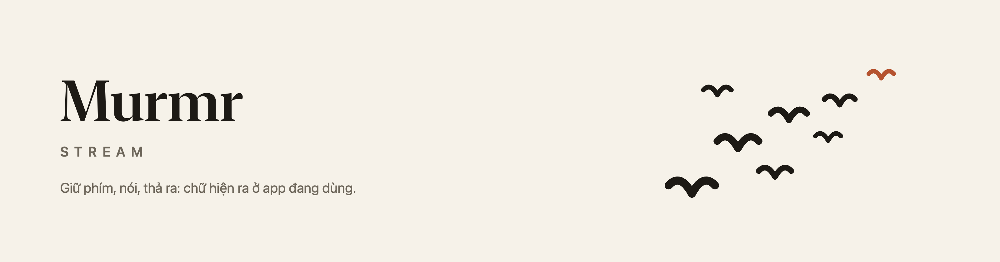
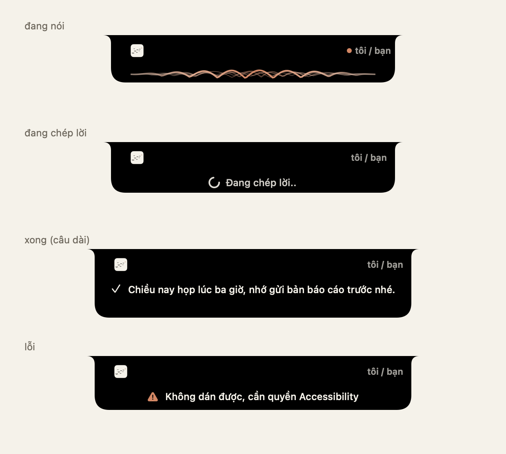
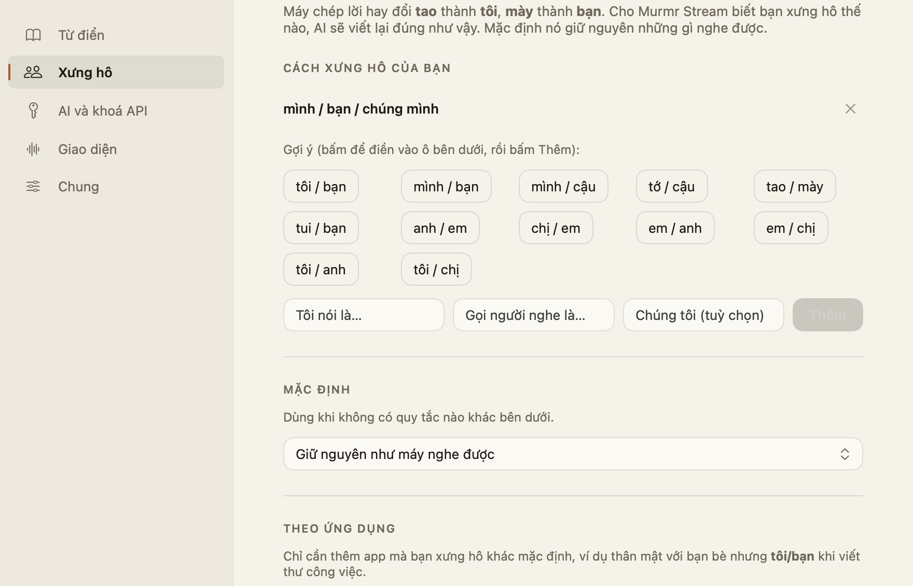
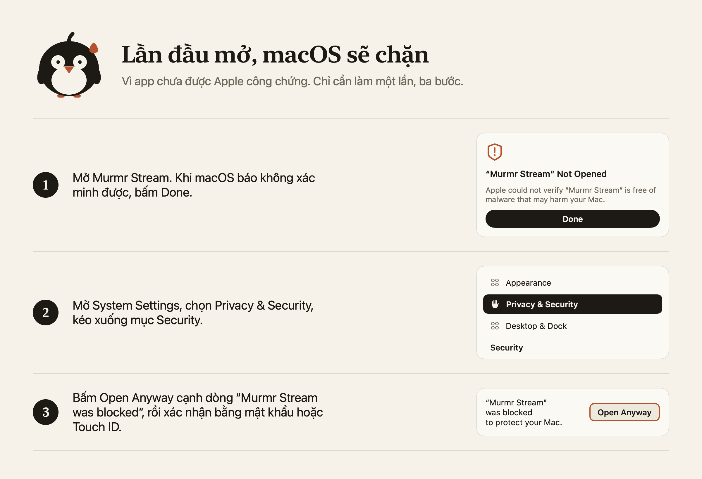
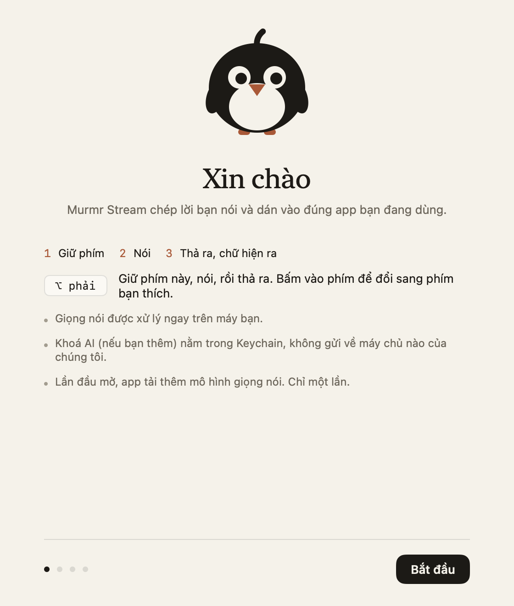

<p align="center"><a href="README.md">English</a> · <b>Tiếng Việt</b></p>

<p align="center">
  <picture>
    <source media="(prefers-color-scheme: dark)" srcset="docs/banner-dark.png">
    
  </picture>
</p>

# Murmr Stream

**Giữ phím, nói, thả ra. Lời bạn nói hiện ngay trong app đang dùng.**

Ứng dụng đọc chính tả miễn phí cho macOS, chạy ngay trên máy bạn, làm riêng cho **tiếng Việt xen lẫn tiếng Anh**. Việc
nhận dạng giọng nói diễn ra trên máy Mac của bạn. Một bước AI tuỳ chọn sẽ dọn lại văn bản.

[](https://github.com/trvux/murmr/releases/latest/download/Murmr-Stream.dmg)
[](https://github.com/trvux/murmr/releases/latest)
[](#cài-đặt)
[](LICENSE)

<p align="center">
  
</p>

## Cách hoạt động

```
giữ phím của bạn -> micro (16 kHz)
   -> whisper-server (ngay trên máy, model luôn nạp sẵn, Metal)   -> chữ thô
   -> AI dọn văn (tuỳ chọn: từ đệm, dấu câu, từ nghe sai)          -> chữ sạch
   -> dán vào app đang dùng (Cmd+V)
```

Phím do bạn chọn. Có thể là một phím bổ trợ đứng một mình (mặc định là ⌥ phải), một phím chức năng, hoặc một tổ hợp.

## Tính năng

| | |
|---|---|
| **Giữ để nói** | Phím hoặc tổ hợp nào bạn chọn, đổi là có hiệu lực ngay, không cần khởi động lại. Không ghi lại bạn gõ gì. |
| **Nhận dạng giọng nói trên máy** | whisper.cpp `large-v3-turbo` kèm bộ phát hiện giọng nói, nên tiếng ồn và khoảng lặng bị bỏ qua thay vì bị biến thành chữ bịa ra. |
| **AI dọn văn** | Bỏ từ đệm, sửa dấu câu và các thuật ngữ tiếng Anh nghe sai, giữ nguyên tiếng Việt và tiếng Anh như bạn nói. Dùng được với DeepSeek, Claude, OpenAI, Gemini, Kimi, OpenRouter, Ollama chạy ngay trên máy bạn, hoặc bất kỳ địa chỉ nào tương thích OpenAI. Không có khoá thì bạn vẫn nhận được chữ thô. |
| **Cách xưng hô của riêng bạn** | Nói thế nào ghi thế ấy: "tao / mày", "tôi / bạn", "mình / cậu", "anh / em". Đặt một mặc định, hoặc riêng cho từng app, từng tiêu đề cửa sổ. App không tự giả định thay bạn. |
| **Từ điển cá nhân** | Tên riêng, thuật ngữ và các cặp sửa `sai -> Đúng`, được đưa cho cả Whisper lẫn AI. Nó cũng học những lỗi lặp lại từ cách bạn dùng. |
| **Riêng tư từ thiết kế** | Không tài khoản, không máy chủ của chúng tôi, không thu thập dữ liệu. Khoá nằm trong Keychain của macOS. Xem [PRIVACY.vi.md](PRIVACY.vi.md). |

<p align="center">
  
</p>

> Giao diện của app hiện đang bằng tiếng Việt.

## Cài đặt

1. [Tải **Murmr-Stream.dmg**](https://github.com/trvux/murmr/releases/latest/download/Murmr-Stream.dmg), mở ra và kéo **Murmr Stream** vào **Applications**.
2. Eject (tháo) ổ đĩa cài đặt, rồi mở app **từ Applications** (không mở từ bên trong ổ đĩa cài đặt: macOS sẽ chạy một bản
   sao tạm và quên các quyền bạn vừa cấp).
3. **Lần đầu, macOS sẽ chặn**, vì app chưa được Apple công chứng (việc đó tốn phí hằng năm mà dự án miễn phí này chưa
   trả). Đây chỉ là một bước làm một lần: bấm **Done** ở cảnh báo, mở **System Settings → Privacy & Security**, kéo
   xuống mục **Security**, bấm **Open Anyway**, rồi xác nhận bằng mật khẩu hoặc Touch ID.

<picture>
  <source media="(prefers-color-scheme: dark)" srcset="docs/first-launch-dark.png">
  
</picture>

Sau đó một cửa sổ chào ngắn sẽ mời bạn chọn phím nói, cho phép ba quyền mà macOS hỏi, và tải các model giọng nói
(574 MB, chỉ một lần). Cần máy Mac chip Apple Silicon và macOS 14 trở lên (build cho 14, đã thử trên macOS 15 trở lên).

<p align="center">
  
</p>

## Cách dùng

1. Bấm vào một ô nhập chữ bất kỳ.
2. Giữ phím của bạn và nói.
3. Thả ra. Chữ được dán vào sau một lát (khoảng 2 đến 3 giây cho một câu ngắn trên M2 Pro).

Cài đặt nằm ở biểu tượng trên thanh menu: từ điển, xưng hô, dịch vụ AI và khoá, giao diện, và phím nói.

## Câu hỏi thường gặp

**macOS báo không mở được app.** Đó là bước lần đầu ở trên: **System Settings → Privacy & Security → Open Anyway**.

**Một quyền báo "chưa cấp" dù công tắc đã bật.** macOS gắn quyền với một bản của một app, ở một chỗ. Hãy chắc là bạn mở
app từ Applications, rồi trong danh sách của System Settings bấm **−** để xoá Murmr Stream và **+** để thêm lại.

**Tôi bấm phím mà không có gì xảy ra.** Cần cấp đủ cả ba quyền (Micro, Giám sát đầu vào, Trợ năng) và các model phải tải
xong. Cửa sổ chào cho thấy cả hai; mở lại nó từ biểu tượng trên thanh menu.

**Không có khoá AI thì dùng được không?** Được. Bạn nhận chữ thô, vốn đã dùng được.

**Cái gì rời khỏi máy tôi?** Âm thanh thì không bao giờ. Khi bật AI dọn văn, phần chữ đã chép đi thẳng từ máy bạn tới
dịch vụ bạn chọn. Tắt AI thì không có gì rời máy. Danh sách đầy đủ nằm trong [PRIVACY.vi.md](PRIVACY.vi.md).

## Tình trạng

Được làm và thử trên một máy (MacBook Pro M2 Pro) và chủ yếu với một giọng nói. Whisper vẫn nghe sai các thuật ngữ
tiếng Anh nói với giọng Việt (ví dụ `crash` thành `cache`); bước dọn văn sửa được nhiều chỗ từ ngữ cảnh, nhưng không hết.

## Dành cho người phát triển

Cách build từ mã nguồn, các lệnh của engine, mọi thiết lập, bảng dịch vụ AI và quy tắc thiết kế nằm trong
[docs/DEVELOPMENT.vi.md](docs/DEVELOPMENT.vi.md). Thay đổi theo từng phiên bản nằm trong [CHANGELOG.md](CHANGELOG.md) (tiếng Anh).

## Giấy phép

MIT, xem [LICENSE](LICENSE). Các thành phần bạn tải riêng (whisper.cpp và model của nó, model Silero VAD, OpenVoice, model
phoneme wav2vec2, espeak-ng) có giấy phép riêng; hãy kiểm tra trước khi phát hành lại bất cứ thứ gì có chứa chúng.
